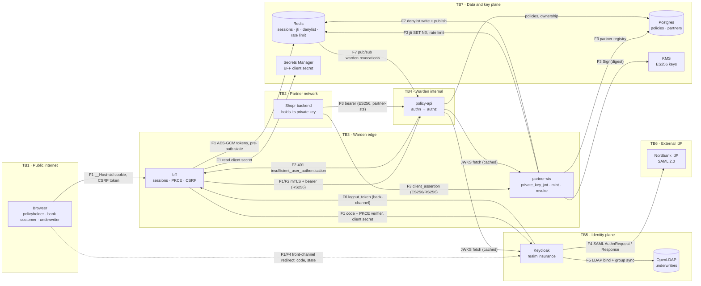

# Warden — Design

Learning project: an identity layer for an embedded-insurance integration
platform that sells policies through partner banks and e-commerce shops.
This document has the actors, the data-flow diagram (DFD) with trust
boundaries, and the numbered flows. `THREAT-MODEL.md` uses the flow IDs
(F1–F7) as its STRIDE row keys.

## Actors

| Actor | Real-world shape | How they authenticate | Enters Warden through | Concept shown |
| --- | --- | --- | --- | --- |
| **Policyholder** | Customer in the insurer's web portal | Keycloak browser SSO (realm `insurance`), password + TOTP or WebAuthn | Browser → `bff` | Auth code + PKCE, BFF sessions, MFA, step-up, logout |
| **Bank customer** | Customer of partner bank "Nordbank" who buys insurance inside the bank's app | The bank's own IdP (SAML 2.0, realm `nordbank`), brokered by Keycloak | Browser → `bff` → Keycloak → Nordbank IdP | Federation, identity brokering, SAML, first-broker-login, `partner_id` claim |
| **Partner backend** | E-commerce shop "Shopr" selling device insurance at checkout | `private_key_jwt` (RFC 7523) to `partner-sts` | Shopr server → `partner-sts`, then → `policy-api` | Custom issuer, KMS signing, JWKS rotation, revocation, introspection |
| **Underwriter** | Insurer employee in the corporate directory | Keycloak LDAP user federation, TOTP required for the role | Browser → `bff` | LDAP/AD, group → role mapping, RBAC |
| *Operator* | Warden admin (demo only) | Admin credential on the STS admin endpoints | `partner-sts` `/admin/*` | Rotation, partner suspend |

## Trust boundaries

| ID | Boundary | Inside | Why it is a boundary |
| --- | --- | --- | --- |
| TB1 | Public internet: user devices | Browser | Untrusted client. Anything it sends is attacker-controlled; it must never hold tokens (ADR-001). |
| TB2 | Partner network | Shopr backend | Authenticated but not trusted: a partner may be compromised or may try to reach another tenant's data (BOLA). |
| TB3 | Warden edge | `bff`, `partner-sts` | The only services that accept traffic from TB1/TB2. They hold secrets (session keys, KMS access). |
| TB4 | Warden internal | `policy-api` | Accepts only bearer tokens; the BFF → API link is mTLS. Partners call it directly, so it validates every token itself and trusts no network position. |
| TB5 | Identity plane | Keycloak (`insurance`), OpenLDAP | Owns human identity and its signing keys. |
| TB6 | External IdP | Keycloak realm `nordbank` (stands in for the bank's SAML IdP) | Another organisation's IdP. Its assertions are verified, never trusted on sight. In the demo it shares the Keycloak container, so the boundary is logical only. |
| TB7 | Data and key plane | Redis, Postgres, KMS (LocalStack) | Holds sessions, denylist, partner registry, policies, signing keys. The STS signing key never leaves KMS. |

## Data-flow diagram

Dashed boxes are trust boundaries. Edge labels name the flow (F1–F7) and what
crosses the boundary.

## Flows

| ID | Flow | Actors | Crosses | Key controls |
| --- | --- | --- | --- | --- |
| F1 | Portal login + API call | Policyholder, underwriter | TB1 → TB3 → TB5, TB3 → TB4 | `state`, `nonce`, PKCE, session ID rotation, `__Host-` cookie, server-side tokens, mTLS, local JWT validation |
| F2 | Step-up for payout change | Policyholder | TB4 → TB3 → TB5 | RFC 9470 challenge, `acr_values=gold&max_age=300`, `acr` + `auth_time` check in `Decide()` |
| F3 | Partner M2M token + API call | Shopr | TB2 → TB3 → TB7, TB2 → TB4 | `private_key_jwt`, `jti` replay cache, scope downscoping, KMS signing, tenant check (BOLA) |
| F4 | Bank customer federation | Bank customer | TB1 → TB5 → TB6 | SAML signature + audience checks (Keycloak), first-broker-login, `partner_id` mapper |
| F5 | Underwriter directory login | Underwriter | TB5 → TB5 (LDAP) | LDAP bind, group → realm role, TOTP required |
| F6 | Logout (RP-initiated + back-channel) | All browser users | TB1 → TB5, TB5 → TB3 | `id_token_hint`, `logout_token` validation, delete every session for `sid` |
| F7 | Revocation fan-out | Operator, Shopr | TB3 → TB7 → TB4 | Denylist TTL = remaining token life, pub/sub push, introspection for high-risk calls |

Not drawn: telemetry export from every service to otel-lgtm (logs are
redacted; no tokens leave a service in logs), and the operator's
`/admin/rotate` and `/admin/partners/{id}/suspend` calls into `partner-sts`.

## Open questions

- Underwriters log in through the same `bff` as policyholders (a separate
  client is not planned). Revisit if role separation needs its own client.
- `nordbank` runs in the same Keycloak as `insurance`, so TB6 is logical. In
  production it would be another organisation's IdP over the internet.
